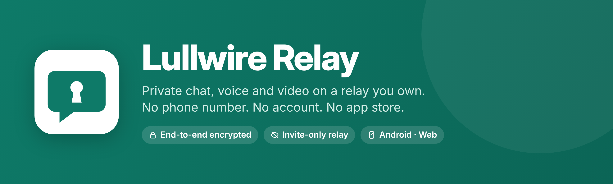

<p align="center"></p>

# Lullwire Relay, formerly Hush Relay

**A small, end-to-end encrypted messenger with file sharing and voice and video calls, running on a relay you own. No accounts, no phone numbers, no app store, and no company in the middle.**

[**Download**](https://github.com/altrudev/Lullwire-Relay/releases/latest) · [Get started](#get-started) · [Host a relay](docs/SELF-HOSTING.md) · [Security](SECURITY.md) · [Protocol](docs/PROTOCOL.md)

## How it works

Lullwire Relay has two parts:

- **The app**, which everyone uses: a web app that opens in any browser (and installs like an app on phones and computers), or the Android app. All encryption happens on your device; your keys never leave it.
- **The relay**, which one person hosts for a group: a mailbox at a web address. It holds sealed envelopes until the recipient's app collects them, and carries calls. It can't read messages or files, or see who sent them.

**The one requirement:** the relay must be at an `https://` address that everyone you invite can reach. That means **web hosting** (upload one file) or **a small server**. A phone or home computer can't be a relay by itself, because home routers and mobile networks block incoming connections. Everyone else only needs the app: your relay's address travels inside your invites.

> ⚠️ **Status: experimental and not independently audited.** The design uses standard building blocks (a Signal-style Double Ratchet on WebCrypto), but it has only had internal adversarial review ([audit log](SECURITY.md#audit-log)), not review by outside cryptographers. Use it for everyday privacy, learning and experiments. **If your safety depends on your messages** (activists, journalists, sources, people facing a hostile government), use [Signal](https://signal.org) or [SimpleX](https://simplex.chat) instead. See [SECURITY.md](SECURITY.md).

## Get started

**To chat** (you were invited): open the invite link. That's all. Then, optionally, install it:

| | How |
|---|---|
| **Any browser** (phone or computer) | Open the invite link, pick a name, chat. Use **Install** (or **Add to Home Screen**; on iPhone, in Safari) to keep it like an app. |
| **Android app** | Download `lullwire-relay-<version>.apk` from [Releases](https://github.com/altrudev/Lullwire-Relay/releases/latest), open it, and paste the invite link on its welcome screen. Official builds are signed by Valentyn Rukhaylo (ALTRU.dev), certificate `38:40:AF:64:…:00:CD:53:19` ([full fingerprint](docs/SELF-HOSTING.md#the-android-app)). |

**To host a relay** (one person per group), choose one; the [hosting guide](docs/SELF-HOSTING.md) has every step:

| | **Web hosting, one file** | **Your own server** |
|---|---|---|
| You need | Web hosting with PHP and HTTPS (cPanel and most shared hosts) | A Linux server (VPS) and a domain name |
| Setup | Upload `lullwire-relay.php`, open it in a browser (5 minutes) | Download the relay, run `lullwire-relay init`, install Caddy (30 minutes) |
| Chats, files, recovery | ✓ | ✓ |
| Voice and video calls | ✗ | ✓ |
| Guide | [Option A](docs/SELF-HOSTING.md#option-a-web-hosting-one-file) | [Option B](docs/SELF-HOSTING.md#option-b-your-own-server-with-calls) |

Then open your relay's address, create your profile, and send invites from there.

**Which download is which:** `lullwire-relay.php` is the relay for web hosting. `lullwire-relay-<version>-<system>` files are the relay **server** program for Linux, Windows, macOS or a Raspberry Pi. They are not a chat app for your computer: on a computer you chat in the browser. `lullwire-relay-<version>.apk` is the Android app.

For people at risk, the guide explains a [hidden setup](docs/SELF-HOSTING.md#hidden-setup-for-people-at-risk) and its limits.

## Features

- **End-to-end encryption with forward secrecy from the first message:** conversations open against a signed prekey (X3DH-style) and then run a Double Ratchet, so a stolen device can't decrypt messages captured earlier.
- **A sealed sender:** the relay can't tell who sent a message. Messages are padded to size classes with a random tail, so the relay learns only a coarse length.
- **Signed addresses:** invites and messages carry a card signed by your identity key, so nobody can swap your mailbox in an intercepted invite, and contacts follow you safely if your address changes.
- **Encrypted on the device:** messages, contacts and keys are stored encrypted. On Android the key sits in the phone's secure Keystore; anywhere, an optional **app lock** passphrase protects them.
- **Files:** send photos, documents and anything else up to 16 MB, end-to-end encrypted like messages. Photos get a preview; the recipient's app checks every file against its SHA-256 before showing it.
- **Voice and video calls:** encrypted end to end with a fresh key per call, carried over your relay's HTTPS connection. No peer-to-peer link, so neither side sees the other's IP address.
- **Private relay:** a hidden path with a plain front page, and invite-only mode so strangers can't use your server. Invite links carry what's needed to join, so friends just tap and start.
- **Owner dashboard:** see how many people use your relay and how actively, make single-use invites, remove someone, and restart the relay, all from your app. Members are anonymous ids to the relay; your app names the ones in your contacts.
- **Android app:** a small APK (no app store, no Google services) built with the plain SDK tools; it blocks screenshots and keeps keys out of cloud backups.
- **Live delivery over one connection:** a single long-lived HTTPS (WebSocket) connection to your relay carries messages in both directions, like any mainstream chat app. Optional **cover traffic** hides when you're actually sending. Messages wait up to 14 days on the relay while you're offline.
- **Background delivery on Android:** messages and calls arrive while the app is closed, with no Google services or push servers. Notifications show no names unless you turn them on.
- **Signed releases:** once installed, the web app only switches to new code signed with the developer's release key (fingerprint `BC36A70831DA314F`, shown in the app under **Settings → App code**).
- **No sign-up:** your identity is a key generated on your device. You add contacts by QR code or invite link.
- **Safety numbers** to check that nobody is in the middle. Strangers who message you arrive as *requests* until you reply.
- **Move your account by QR:** scan a one-time code from your old device and approve after matching a 12-digit code.
- **8 recovery words:** an encrypted backup kept on your relay, so you can get your account back on any device. The relay can't open it. (6-word sets from earlier versions still work and can be upgraded in Settings.)
- **Different relays talk to each other:** each person can use a different relay, in any country.
- **No dependencies:** vanilla JS, WebCrypto and WebCodecs in the browser; a Go relay built only on the standard library (or one PHP file); a Java Android shell with no libraries. Three small vendored libraries handle QR codes and the wordlist.

## Try it locally (developers, 1 minute)

```bash
git clone https://github.com/altrudev/Lullwire-Relay.git lullwire-relay
cd lullwire-relay
go build -o lullwire-relay ./cmd/lullwire-relay && ./lullwire-relay     # Go 1.22+
# or, with PHP 7.4+:  ./scripts/serve.sh
```

Open http://localhost:8080 in two different browsers (or one normal and one private window). Create a profile in one, tap **Invite someone** and open that link in the other. This only works on your own computer; to chat with other people, [host a relay](docs/SELF-HOSTING.md).

## Using it

1. **Create a profile.** Pick a display name. Opened from an invite link, everything else is filled in.
2. **Invite someone.** Tap **Invite someone** and share the link (any messenger, email or SMS) or let them scan the QR. They open it, pick a name, and you're connected.
3. **Verify once.** Tap the yellow bar in the chat and compare the safety code in person or on a call, then tap **They match**.
4. **Send a file.** Tap the paperclip next to the message box and pick a file (up to 16 MB). The other side sees it arrive, with a preview for photos, and **Save** keeps a copy.
5. **Call.** The phone and camera buttons in the chat header start an encrypted voice or video call (when your relay supports calls).
6. **Turn on recovery words** in **Settings** and write the 8 words down. They're the only thing you need to get your profile back.
7. **New phone?** On it, choose **From my other device**. On the old one, tap **Scan**, check the 12-digit code matches and approve. The profile moves over, and the old device signs out.

On Android you can also install the [app](docs/SELF-HOSTING.md#android-app); paste an invite link on its welcome screen, or share the link to it.

Links opened from outside the app (a web page, another app, a shared text) always ask before adding a contact, and can never start a profile move: move codes are only accepted from **Scan**.

## Repository layout

```
cmd/lullwire-relay/ Go relay: one binary, app built in, standard library only
  live.go       WebSocket call rooms (RFC 6455, standard library)
  mail.go       live mail over the same WebSocket
  init.go       the setup wizard (lullwire-relay init); config.go reads its settings file
cmd/lullwire-release/ signs the web app (release key, release.json)
web/            the app (and the PHP relay)
  index.html    UI (style.css: its stylesheet)
  app.js        crypto core, encrypted vault + app logic (also loadable in Node for tests)
  call.js       encrypted calls: WebCodecs (Opus, VP8) + AES-GCM frames
  worklet.js    audio capture and playback for calls
  relay.php     the PHP mailbox relay, "lite": messages only, no new features (same API and data layout)
  embed.go      tells the Go build which app files to include
  config.js     optional default relay URL (used for IPFS builds)
  sw.js         offline support; runs only code signed with the release key (release.json)
  vendor/       qrcode-generator (MIT), jsQR (Apache-2.0), BIP39 wordlist (MIT)
scripts/
  serve.sh      run app + relay with PHP's built-in server
  router.php    keeps the data folder private under php -S
  publish-ipfs.sh
android/        Android app: Java WebView shell, no libraries; build.sh uses the plain SDK tools
assets/brand/   logo, icons, banner, social preview, install guide (and render.py to rebuild them)
tests/
  run.sh        full test suite against a throwaway relay
  android/      two-person device test on an emulator (app + browser, video call)
  core.test.js  crypto, ratchet, protocol v4, vault, relay API, recovery, linking
  compat.test.js  Lullwire 0.6 <-> Hush Relay 0.5 (frozen copy in fixtures/)
  e2e.py        multi-browser test (Playwright); sw.py: signed releases in the browser
docs/
  SELF-HOSTING.md  PROTOCOL.md  RELEASING.md
```

## Documentation

- [Project overview, scope and status](ABOUT.md)
- [Protocol and threat assumptions](docs/PROTOCOL.md)
- [Self-hosting and deployment](docs/SELF-HOSTING.md)
- [Security limitations and vulnerability reporting](SECURITY.md)
- [Contributing and local test procedure](CONTRIBUTING.md)
- [Third-party attribution and licensing](LICENSES.md) · [NOTICE](NOTICE) · [Brand guide](assets/brand/README.md)
- [Release history](CHANGELOG.md)

## Tests

```bash
./tests/run.sh --go     # Go relay: gofmt, vet, unit tests (race-safe), then the shared suite (needs go + node 20+)
./tests/run.sh          # PHP relay (needs php + node 20+)
# add --e2e for five real browsers incl. an encrypted video call (pip install playwright && playwright install chromium)
SERIAL=emulator-5554 ./tests/android/run.sh   # Android app on an emulator (needs the Android SDK)
```

## Limits

- **A relay needs web hosting or a server** reachable at an `https://` address; it can't run on a phone or home computer by itself (see [How it works](#how-it-works)).
- **One-to-one only:** no group chats yet.
- **Files up to 16 MB.** Relays keep up to 48 MiB waiting per person (relays older than 0.7: 8 MiB).
- **Calls need the Go relay, are one-to-one** and go through the caller's relay, which sees that a call happened, how long it lasted and roughly how much data it used, but not what was said or shown.
- **One active device per account.** Linking moves an account; it doesn't add a second device.
- **Message history stays on the device that received it.**
- **The relay operator sees metadata:** IP addresses, timing, size bucket and which mailbox gets mail. They can't see content or senders.
- **The web delivery problem:** once installed, the web app only accepts code signed with the release key, but a fully compromised server can still replace the service worker that enforces this. The Android app and a pinned IPFS CID don't have this problem.
- **No push notifications in the browser.** The Android app delivers in the background; in a browser, messages arrive while the app is open.

## Contributing

Issues and pull requests are welcome, especially security review. Contributors agree to the [Contributor License Agreement](CLA.md) once, on their first pull request; you keep your copyright. Please report vulnerabilities privately as described in [SECURITY.md](SECURITY.md).

## License

Copyright © 2026 Valentyn Rukhaylo (ALTRU.dev).

Original Lullwire Relay code and documentation are licensed under the **GNU Affero General Public License v3.0 or later** (SPDX: `AGPL-3.0-or-later`). The complete license is in [LICENSE](LICENSE). For hosted modified versions, AGPL section 13 may require providing the corresponding source to network users; see [LICENSES.md](LICENSES.md) for an overview. AGPL permits commercial use provided its terms are followed.

Vendored components remain under their respective MIT or Apache-2.0 terms, detailed in [LICENSES.md](LICENSES.md) and the accompanying notice files. The "Lullwire Relay" name and logo are not licensed as trademarks: forks that ship modified builds need their own name and icon ([brand guide](assets/brand/README.md)). No separate proprietary license is granted by this repository; commercial licenses are available from the maintainer.

## Author


**Lullwire Relay** is created, designed and maintained by **Valentyn (Val) Rukhaylo**, [ALTRU.dev](https://altru.dev) — *Code for Humanity*.<br>
Issues, ideas and security reports are welcome.
<br clear="left">
